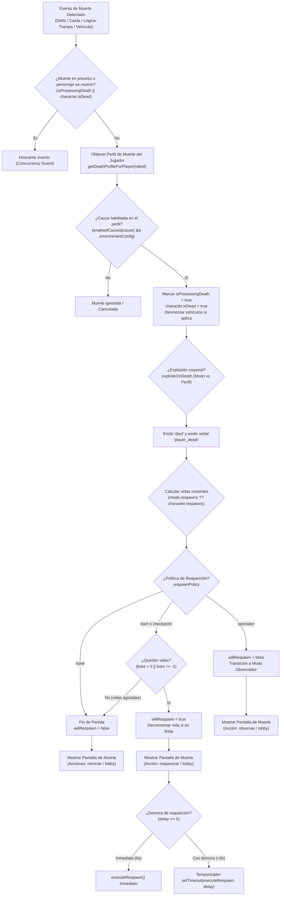
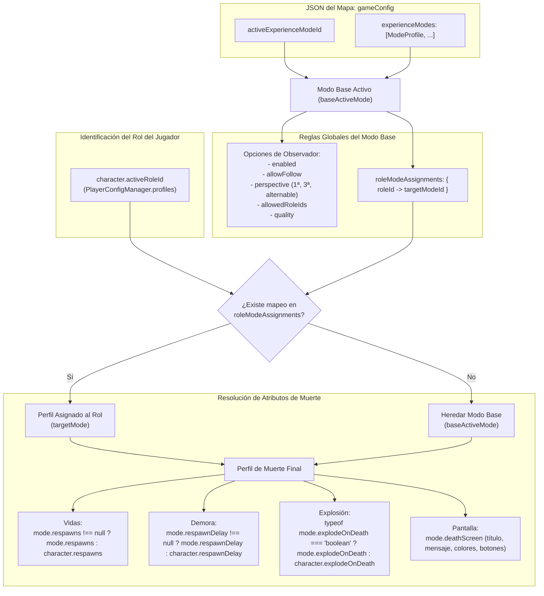
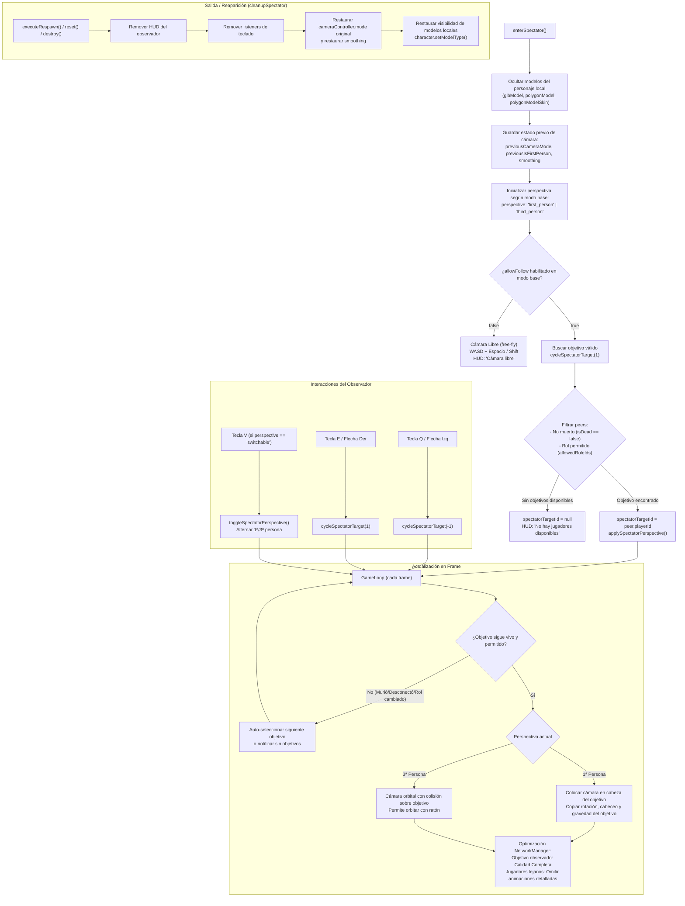
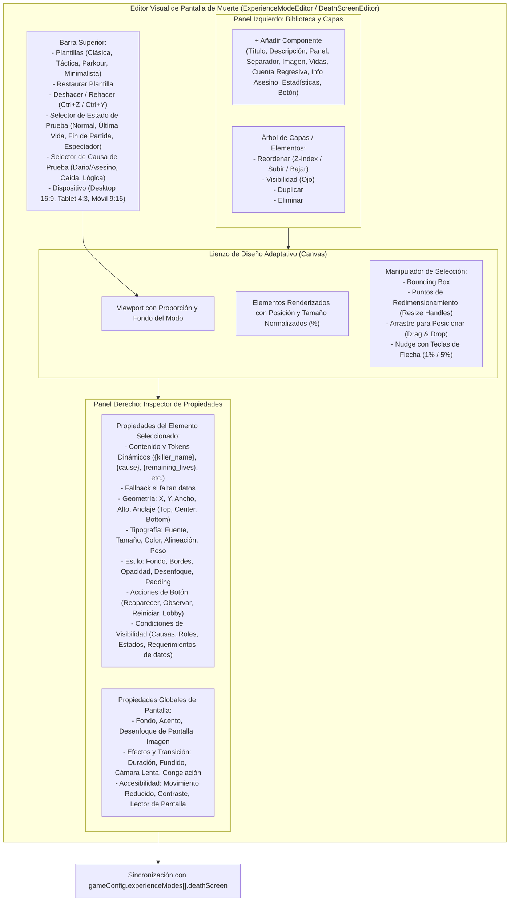
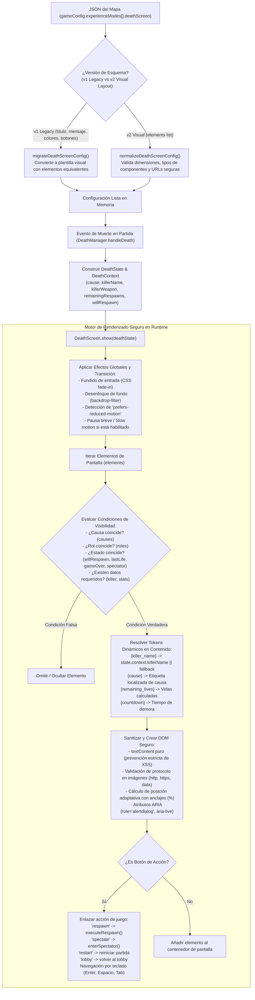
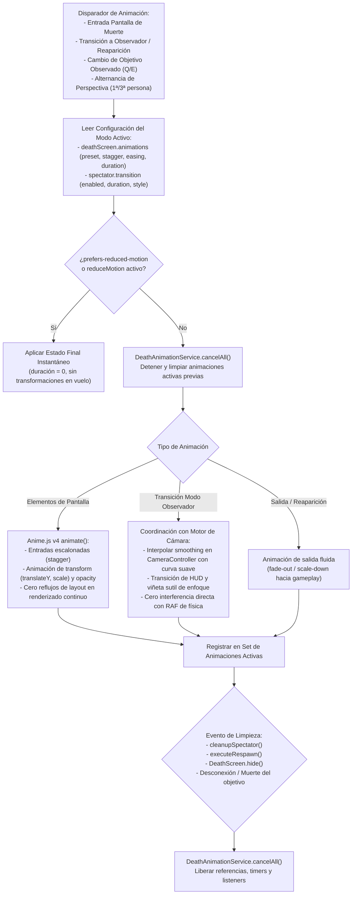
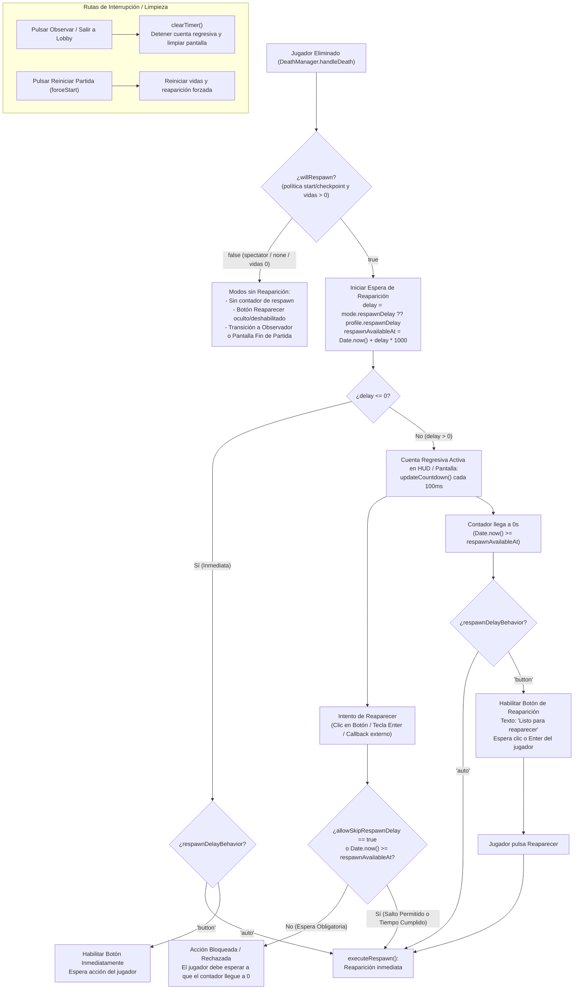
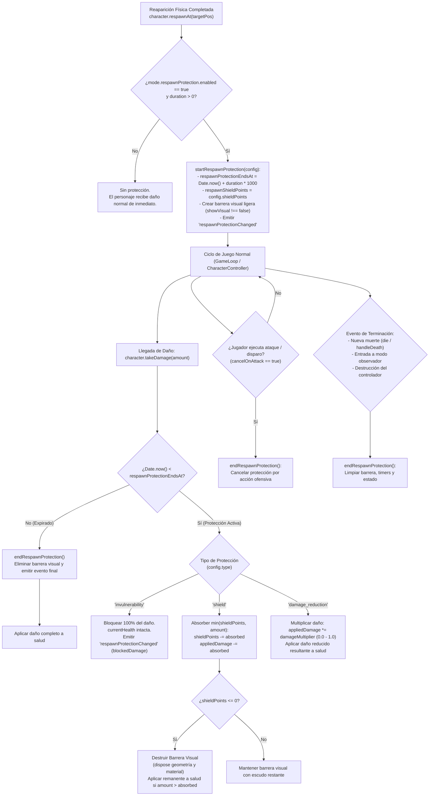
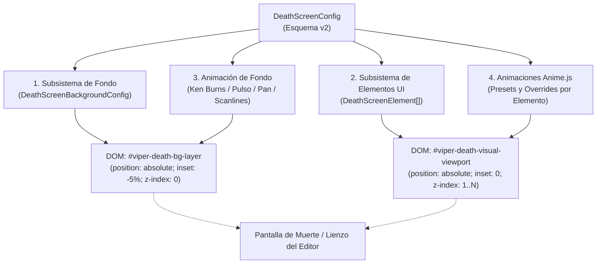

# Arquitectura del Sistema de Muerte, Reaparición y Modo Observador

Este documento define la arquitectura formal, los flujos de ejecución y las reglas de resolución de configuración para el sistema de muerte, reaparición, perfiles de rol y modo observador en viper.io (THREE-game).

---

## 1. Reglas de Configuración y Fuente Única de Verdad

### 1.1 Jerarquía y Almacenamiento
- **Persistencia en el Mapa**: Toda la configuración de modos de experiencia se almacena en el archivo JSON del mapa bajo `gameConfig.experienceModes` y `gameConfig.activeExperienceModeId`.
- **Prohibición de Configuración Externa**: Ninguna regla de experiencia o muerte se guarda en `.env` ni en la configuración global del perfil de jugador.
- **Compatibilidad Hacia Atrás**: Si un mapa carece de modos (`experienceModes` ausente o vacío), `normalizeExperienceModesConfig()` genera automáticamente los tres modos predeterminados (`mode_survival`, `mode_racing`, `mode_elimination`) manteniendo como activo `mode_survival`.

### 1.2 Distinción entre Modo Base de Experiencia y Perfiles de Muerte por Rol
1. **Modo Base Activo (`baseActiveMode`)**:
   - Es el modo principal de la partida (`activeExperienceModeId`).
   - Controla las **reglas globales de la partida y del observador**:
     - `spectator.enabled`: Si se permite o no observar al ser eliminado.
     - `spectator.allowFollow`: Si se permite seguir a otros jugadores o únicamente cámara libre.
     - `spectator.perspective`: Perspectiva permitida (`first_person`, `third_person`, `switchable`).
     - `spectator.allowedRoleIds`: Lista blanca de roles que pueden ser observados (vacío = todos).
     - `spectator.quality`: Nivel de optimización gráfica durante observación (`full`, `balanced`, `low`).
     - `roleModeAssignments`: Mapeo de roles a perfiles de muerte específicos (`Record<roleId, modeId>`).
2. **Perfil de Muerte del Jugador (`deathProfile`)**:
   - Resuelto individualmente para cada jugador según su rol (`character.activeRoleId`).
   - Si `baseActiveMode.roleModeAssignments[roleId]` existe y apunta a un modo válido, dicho jugador utiliza ese perfil de muerte.
   - Si no hay asignación, hereda y utiliza el `baseActiveMode`.
   - Controla exclusivamente las **reglas al morir**:
     - `enabledCauses`: Causas activas (daño, caída, lógica).
     - `respawns`: Cantidad de vidas (o herencia del perfil del jugador).
     - `respawnDelay`: Tiempo de espera para reaparecer (o herencia).
     - `explodeOnDeath`: Si explota en partes o no (o herencia).
     - `respawnPolicy`: Política elegida (`start`, `checkpoint`, `spectator`, `none`).
     - `deathScreen`: Personalización visual (título, mensaje, colores, botones, desenfoque).

---

## 2. Diagramas Mermaid de Arquitectura

### 2.1 Flujo de Causas de Muerte a Política de Reaparición

---

### 2.2 Resolución de Configuración: Modo Base vs Rol y Herencia

---

### 2.3 Flujo del Modo Observador

---

## 3. Puntos de Incoherencia Identificados y Solución Unificada

Durante la auditoría del código previa a la consolidación, se detectaron los siguientes puntos:

1. **Confusión entre Modo Base y Perfil de Muerte en Observación**:
   - *Problema previo*: Si un jugador con rol asignado moría, `DeathManager.getActiveMode()` devolvía el modo del rol, y las funciones del observador leían `spectator` de dicho modo en vez del modo base de la partida.
   - *Regla unificada*: Se separa formalmente `getBaseActiveMode()` (que rige `spectator.*` y `roleModeAssignments`) de `getDeathProfileForPlayer()` (que rige vidas, demora, política y pantalla de muerte).

2. **Filtro de Controles en el HUD**:
   - *Problema previo*: Si había un solo jugador en la partida o el seguimiento estaba deshabilitado, el HUD podía seguir mostrando textos de atajos como `Q/E para cambiar`.
   - *Regla unificada*: El HUD únicamente anuncia controles interactivos que sean viables en el estado actual (ej. solo muestra `Q/E` si hay más de 1 objetivo disponible; solo muestra `V` si la perspectiva es `switchable`).

3. **Prevención de Pérdida de Objetivo Sin Ciclos**:
   - *Problema previo*: Al morir o desconectarse un jugador observado, la validación no debía entrar en recursión infinita si todos los jugadores habían muerto.
   - *Regla unificada*: Se realiza un escaneo de una sola pasada sobre los jugadores remotos disponibles. Si la lista filtrada queda vacía, se limpia `spectatorTargetId` inmediatamente y se informa al usuario.

---

## 4. Arquitectura del Editor Visual de Pantalla de Muerte

### 4.1 Diagrama del Editor Visual (UI, Canvas, Biblioteca, Propiedades y Estado)

### 4.2 Flujo de Configuración a Renderizado en Tiempo de Ejecución

### 4.3 Principios de Seguridad y Accesibilidad

1. **Seguridad contra Inyección**:
   - Queda terminantemente prohibido el uso de `innerHTML` o evaluación de scripts (`eval`, `Function`, `javascript:`) a partir de cadenas almacenadas en el mapa.
   - Las imágenes e iconos solo admiten esquemas seguros (`http:`, `https:`, `data:image/`, o rutas relativas locales).
   - Los botones de acción solo pueden ejecutar una lista cerrada de acciones del juego (`respawn`, `spectate`, `restart`, `lobby`).
2. **Accesibilidad Integral**:
   - `prefers-reduced-motion`: Si el sistema del usuario tiene activada la reducción de movimiento, las transiciones de fundido y desenfoque dinámico se simplifican instantáneamente sin animaciones bruscas.
   - Navegación por teclado: Los botones reciben foco secuencial mediante `tabindex="0"`; `Enter` o `Espacio` activa el botón con foco o el botón primario por defecto; `Escape` permite cerrar en modo previsualización.
   - Roles ARIA: El contenedor utiliza `role="alertdialog"`, `aria-modal="true"`, y la cuenta regresiva o mensajes dinámicos se anuncian con `aria-live="polite"`.
3. **Resiliencia ante Datos Faltantes**:
   - Si una plantilla hace referencia a `{killer_name}` pero la muerte fue por caída o trampa ambiental, se utiliza el texto de reemplazo configurado por el creador o se oculta el elemento sin romper el layout ni lanzar excepciones de JavaScript.

---

## 5. Sistema de Animaciones y Transiciones de Alto Rendimiento (Anime.js v4)

### 5.1 Diagrama del Ciclo de Vida de Animaciones

### 5.2 Decisiones de Arquitectura y Rendimiento

1. **Uso de Anime.js v4 y Carga Diferida (Code-Splitting)**:
   - Se utiliza la API oficial v4 de Anime.js (`animate(targets, parameters)`).
   - Se aísla y centraliza toda la interacción con Anime.js dentro de `DeathAnimationService`, cargando Anime.js de forma dinámica mediante `loadAnime()` y empaquetándolo en un chunk separado (`dist/assets/animejs-*.js`).
   - Esto evita sobrecargar el bundle inicial del cliente (`index-*.js`). Si la librería aún no ha terminado de cargarse al momento del primer renderizado de muerte, los elementos se revelan inmediatamente en su estado final (`opacity: 1`, transform base) sin demoras perceptibles ni bloqueos de fotograma.
2. **Estabilidad de Cámara y Transición Ligera en HUD**:
   - `CameraController` calcula `camera.position` a partir de la posición del personaje y el trazado de rayos contra el escenario (`third-person-collision`), mientras que `smoothing` gobierna únicamente la interpolación de `currentLookAt`. Reducir `smoothing` durante un cambio de objetivo provocaría que la cámara se mueva instantáneamente al nuevo jugador pero mire hacia atrás (al jugador anterior), produciendo un giro desorientador y compitiendo con la física de la cámara.
   - Por tanto, se mantiene el comportamiento estable y seguro contra colisiones de `CameraController`, evitando alterar su lógica central. La transición visual al cambiar de objetivo (`Q`/`E`), alternar perspectiva (`V`) o entrar al modo observador se canaliza a través de un pulso ligero de `scale` y `opacity` en el HUD del espectador.
   - En caso de alternancias rápidas de objetivo, la transición previa se cancela de inmediato, restaurando el estado base antes de iniciar la nueva, sin animaciones concurrentes sobre el mismo elemento.
3. **Mapeo Estricto de Elementos Condicionales por ID**:
   - En `animateScreenEntrance()`, la animación vincula cada elemento por su identificador único (`elementId`). Si un elemento condicional (por causa de muerte, rol o falta de datos como `killer_name`) fue omitido del DOM por la lógica de visibilidad, se ignora limpiamente y **no** se sustituye por el nodo correspondiente a su índice en `childNodes`.
4. **Cancelación por Ámbitos (Scopes) e Invalidación de Callbacks**:
   - Se manejan ámbitos separados: `cancelScreenAnimations()` y `cancelSpectatorAnimations()`. Ocultar la pantalla de muerte no cancela el HUD del observador ni viceversa.
   - Las animaciones de salida (`animateScreenExit`) utilizan tokens de ejecución para garantizar que, si una animación es cancelada o la pantalla se oculta antes de finalizar, los callbacks de reaparición o navegación no se ejecuten de manera residual.
5. **Accesibilidad**:
   - Soporte total para `prefers-reduced-motion` y selector en la experiencia; ante reducción de movimiento, las transiciones se completan inmediatamente sin transformaciones intermedias.

## 6. Sistema de Espera de Reaparición Real y Protección Posterior al Respawn

La espera antes de reaparecer y la protección después de reaparecer son fases temporales y conceptuales completamente desacopladas:
- **Espera de reaparición (Pre-Respawn):** Define cuándo y cómo se permite la vuelta al mundo del jugador eliminado (reaparición automática al llegar a 0, habilitación del botón al llegar a 0, o salto opcional). Durante esta fase el jugador está muerto o en pantalla de muerte; **nunca** tiene protección activa.
- **Protección posterior al respawn (Post-Respawn):** Se inicia **únicamente después de que el personaje ha completado su reaparición física en el mundo** (`respawnAt()`). Ofrece invulnerabilidad, absorción por escudo o mitigación porcentual, con opción de barrera visual y cancelación selectiva.

### 6.1 Diagrama de Estados: Espera de Reaparición y Acciones de Pantalla

### 6.2 Diagrama de Ciclo de Vida: Protección Posterior al Respawn

### 6.3 Autoridad de Simulación y Limitación Arquitectónica

- **Autoridad Cliente en Gameplay**: En la arquitectura actual de `viper.io (THREE-game)`, el servidor WebSocket (`server/`) gestiona autenticación, almacenamiento de mapas/prefabs, sincronización de posiciones de salas (`RoomManager`) y retransmisión de estados multijugador. La física, la salud del personaje, la detección de muerte y el temporizador de reaparición son simulados y validados localmente por el cliente en `CharacterController` y `DeathManager`.
- **Espera en Cliente**: La obligatoriedad de la espera y la protección posterior se ejecutan a nivel del bucle de juego local del cliente. Por diseño actual del repositorio, la espera no es autoritativa en el servidor backend contra clientes modificados; garantiza consistencia de experiencia de usuario, reglas de modo y prevención de saltos por teclado, animaciones o UI.

### 6.4 Cobertura de Daño y Distinción con Caída al Vacío

1. **Daño Cubierto (`takeDamage`)**:
   - Daño por proyectiles de armas (`projectiles`).
   - Daño por colisión de vehículos y motos (`VehicleSystem`, `VehicleDurability`).
   - Daño por estelas de luz / muros de Tron (`VehicleTronWall`).
   - Daño por controladores de peligro y trampas de mapa (`enableDamage` en `GameEditor`).
   - Daño cuerpo a cuerpo de otros jugadores o PNJs.
2. **Caída al Vacío (`cause: "fall"`)**:
   - La caída por debajo del límite del mundo (`fallDeathY`) no es una resta de puntos de salud: es una eliminación directa por salir de los confines del mapa (`DeathCause = "fall"`).
   - Por tanto, la protección posterior al respawn protege la salud contra daño físico y ambiental, pero si el jugador reaparece o camina directamente hacia el abismo exterior, la política de caída del mapa continuará procesándose como muerte instantánea out-of-bounds.
3. **Cancelación al Atacar (`cancelOnAttack`)**:
   - `InputManager` marca `keys.attack = true` ante cualquier pulsación con botón 0 del ratón, lo cual incluye hacer clic en la escena 3D o en manipuladores. Para evitar falsos positivos que cancelen la protección al interactuar con el entorno, la cancelación al atacar se vincula estrictamente a la ejecución de acciones ofensivas (`useCurrentItem` con armas de proyectil o disparo verificado), y es configurable por modo.

---

## 7. Personalización Visual Desacoplada de la Pantalla de Muerte

### 7.1 Principio de Composición Independiente

Para permitir libertad creativa total al diseñador de experiencias, el sistema desacopla cuatro subsistemas visuales que anteriormente estaban entrelazados:

1. **Fondo Propio y Composición de Legibilidad**:
   - **Tipos de Fondo**: `"color"` (color plano sin degradados forzados), `"gradient"` (degradados radiales, verticales u oscuros cinematográficos), `"image"` (imagen local o externa) y `"animated"` (imagen/gradiente con movimiento).
   - **Ajuste y Posición de Imagen**: Soporte de `imageFit` (`cover`, `contain`, `fill`) y `imagePosition` (`center`, `top center`, `bottom center`).
   - **Capa de Legibilidad (`overlayColor` + `overlayOpacity`)**: Permite atenuar u oscurecer la imagen de fondo con opacidad configurable (0 a 100%) para asegurar el contraste de textos y botones sin alterar el archivo de imagen original.
2. **Independencia Absoluta de Elementos**:
   - Si el creador configura únicamente botones sobre su imagen de fondo, el motor renderiza exclusivamente esos botones. No se inyectan tarjetas, paneles ni títulos predeterminados.
3. **Aislamiento de Animaciones de Fondo**:
   - Las animaciones de fondo operan en una capa DOM dedicada (`#viper-death-bg-layer`), aislada del árbol de elementos UI.
   - Utilizan transformaciones GPU (`scale`, `translate`, `filter`, `will-change: transform`) para evitar reflows y recalculación de layout del navegador.
   - Soportan: `ken_burns` (zoom lento y suave deriva), `pulse_glow` (pulso de brillo y contraste), `pan` (barrido horizontal continuo) y `scanlines` (retícula y líneas de barrido militar).
4. **Animaciones de Elementos (Anime.js v4) por Preset y Override Individual**:
   - **Presets con Identidad**:
     - `subtle`: Deslizamiento suave y fluido.
     - `dramatic`: Escala con impacto y anticipación (`easeOutBack`).
     - `arcade`: Rebote dinámico y enérgico (`easeOutElastic`).
     - `cinematic`: Desenfoque progresivo y elegancia (`blur_in`).
     - `tactical`: Entrada rápida estilo HUD militar (`easeOutQuad`).
     - `speed`: Deslizamiento lateral veloz con impacto direccional.
     - `minimalist`: Fundido limpio y directo sin distracciones.
     - `none`: Aparición instantánea.
   - **Override por Elemento**: Cada elemento puede anular el efecto de entrada (`type`), duración (`duration`), retardo (`delay`) y curva de aceleración (`easing`).
5. **Accesibilidad y Rendimiento**:
   - Respeto prioritario a `prefers-reduced-motion` y `accessibility.reduceMotion`: desactiva las animaciones de fondo y revela los elementos al instante sin transiciones de movimiento.
   - Sanitización de URLs con `sanitizeImageUrl` para mitigar ataques XSS.
