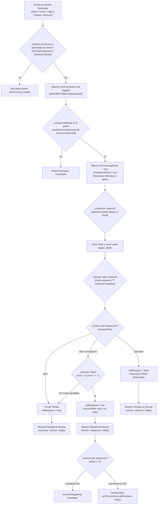
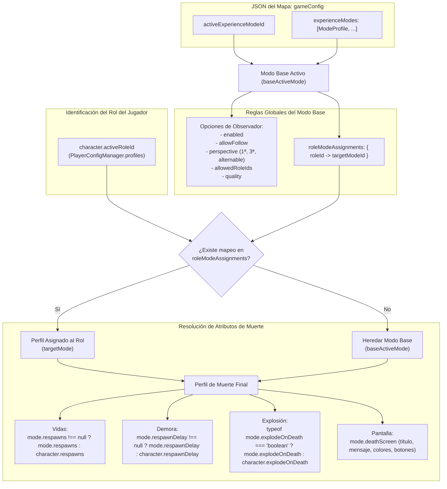
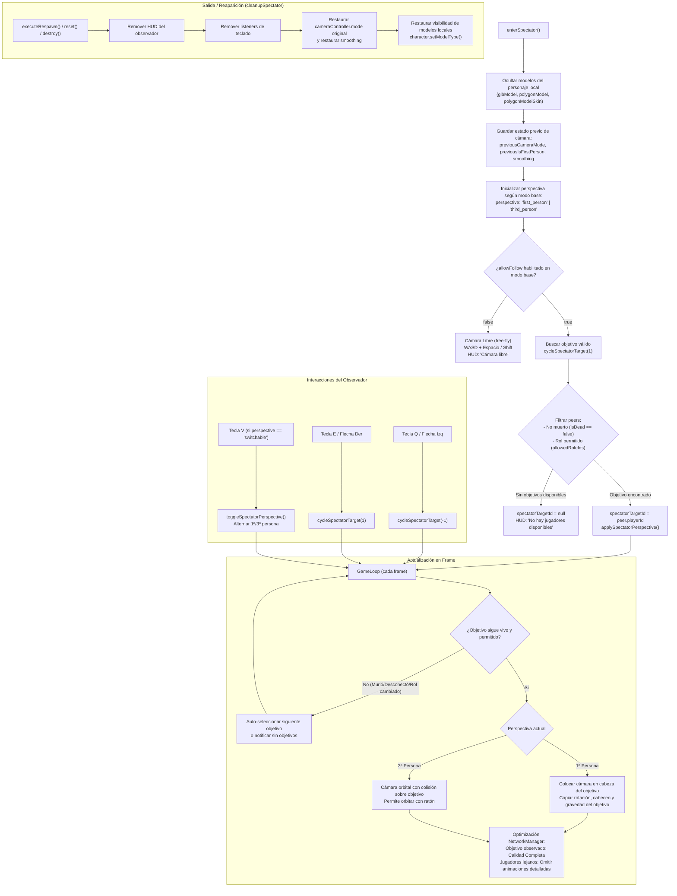

# Arquitectura del Sistema de Muerte, Reaparición y Modo Observador

Este documento define la arquitectura formal, los flujos de ejecución y las reglas de resolución de configuración para el sistema de muerte, reaparición, perfiles de rol y modo observador en viper.io (THREE-game).

---

## 1. Reglas de Configuración y Fuente Única de Verdad

### 1.1 Jerarquía y Almacenamiento
- **Persistencia en el Mapa**: Toda la configuración de modos de experiencia se almacena en el archivo JSON del mapa bajo `gameConfig.experienceModes` y `gameConfig.activeExperienceModeId`.
- **Prohibición de Configuración Externa**: Ninguna regla de experiencia o muerte se guarda en `.env` ni en la configuración global del perfil de jugador.
- **Compatibilidad Hacia Atrás**: Si un mapa carece de modos (`experienceModes` ausente o vacío), `normalizeExperienceModesConfig()` genera automáticamente los tres modos predeterminados (`mode_survival`, `mode_racing`, `mode_elimination`) manteniendo como activo `mode_survival`.

### 1.2 Distinción entre Modo Base de Experiencia y Perfiles de Muerte por Rol
1. **Modo Base Activo (`baseActiveMode`)**:
   - Es el modo principal de la partida (`activeExperienceModeId`).
   - Controla las **reglas globales de la partida y del observador**:
     - `spectator.enabled`: Si se permite o no observar al ser eliminado.
     - `spectator.allowFollow`: Si se permite seguir a otros jugadores o únicamente cámara libre.
     - `spectator.perspective`: Perspectiva permitida (`first_person`, `third_person`, `switchable`).
     - `spectator.allowedRoleIds`: Lista blanca de roles que pueden ser observados (vacío = todos).
     - `spectator.quality`: Nivel de optimización gráfica durante observación (`full`, `balanced`, `low`).
     - `roleModeAssignments`: Mapeo de roles a perfiles de muerte específicos (`Record<roleId, modeId>`).
2. **Perfil de Muerte del Jugador (`deathProfile`)**:
   - Resuelto individualmente para cada jugador según su rol (`character.activeRoleId`).
   - Si `baseActiveMode.roleModeAssignments[roleId]` existe y apunta a un modo válido, dicho jugador utiliza ese perfil de muerte.
   - Si no hay asignación, hereda y utiliza el `baseActiveMode`.
   - Controla exclusivamente las **reglas al morir**:
     - `enabledCauses`: Causas activas (daño, caída, lógica).
     - `respawns`: Cantidad de vidas (o herencia del perfil del jugador).
     - `respawnDelay`: Tiempo de espera para reaparecer (o herencia).
     - `explodeOnDeath`: Si explota en partes o no (o herencia).
     - `respawnPolicy`: Política elegida (`start`, `checkpoint`, `spectator`, `none`).
     - `deathScreen`: Personalización visual (título, mensaje, colores, botones, desenfoque).

---

## 2. Diagramas Mermaid de Arquitectura

### 2.1 Flujo de Causas de Muerte a Política de Reaparición

---

### 2.2 Resolución de Configuración: Modo Base vs Rol y Herencia

---

### 2.3 Flujo del Modo Observador

---

## 3. Puntos de Incoherencia Identificados y Solución Unificada

Durante la auditoría del código previa a la consolidación, se detectaron los siguientes puntos:

1. **Confusión entre Modo Base y Perfil de Muerte en Observación**:
   - *Problema previo*: Si un jugador con rol asignado moría, `DeathManager.getActiveMode()` devolvía el modo del rol, y las funciones del observador leían `spectator` de dicho modo en vez del modo base de la partida.
   - *Regla unificada*: Se separa formalmente `getBaseActiveMode()` (que rige `spectator.*` y `roleModeAssignments`) de `getDeathProfileForPlayer()` (que rige vidas, demora, política y pantalla de muerte).

2. **Filtro de Controles en el HUD**:
   - *Problema previo*: Si había un solo jugador en la partida o el seguimiento estaba deshabilitado, el HUD podía seguir mostrando textos de atajos como `Q/E para cambiar`.
   - *Regla unificada*: El HUD únicamente anuncia controles interactivos que sean viables en el estado actual (ej. solo muestra `Q/E` si hay más de 1 objetivo disponible; solo muestra `V` si la perspectiva es `switchable`).

3. **Prevención de Pérdida de Objetivo Sin Ciclos**:
   - *Problema previo*: Al morir o desconectarse un jugador observado, la validación no debía entrar en recursión infinita si todos los jugadores habían muerto.
   - *Regla unificada*: Se realiza un escaneo de una sola pasada sobre los jugadores remotos disponibles. Si la lista filtrada queda vacía, se limpia `spectatorTargetId` inmediatamente y se informa al usuario.
